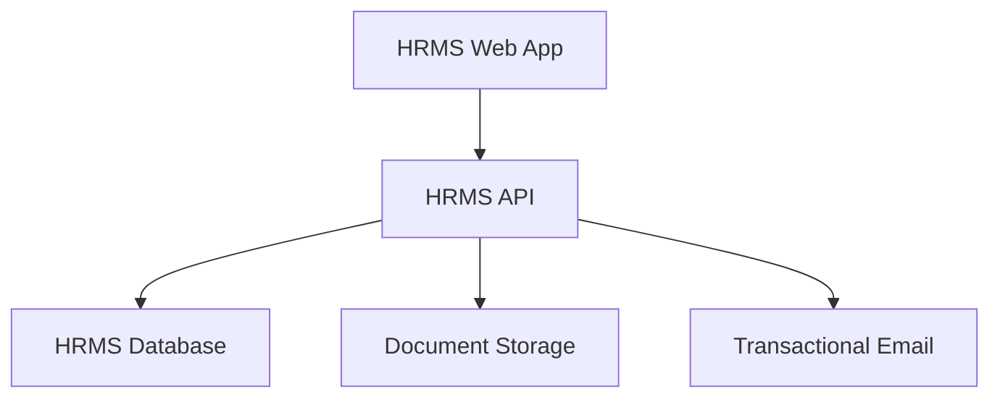
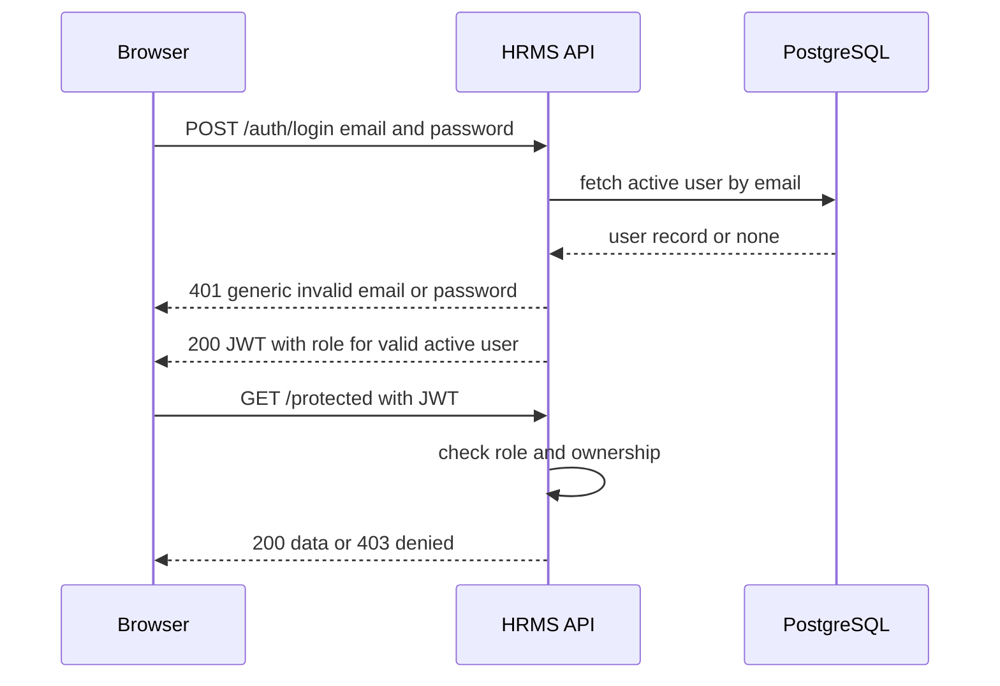
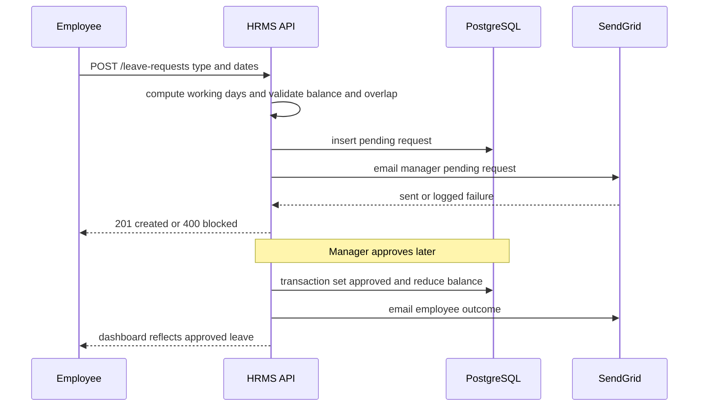
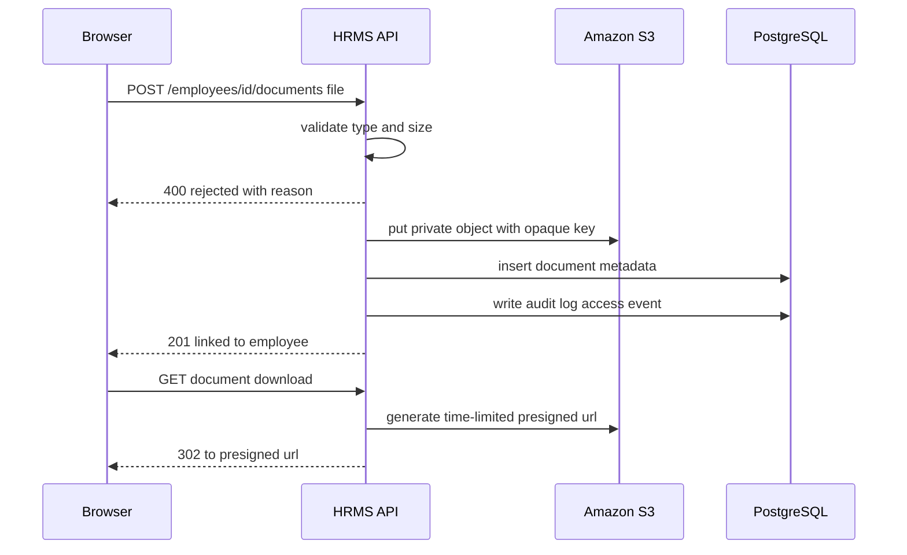
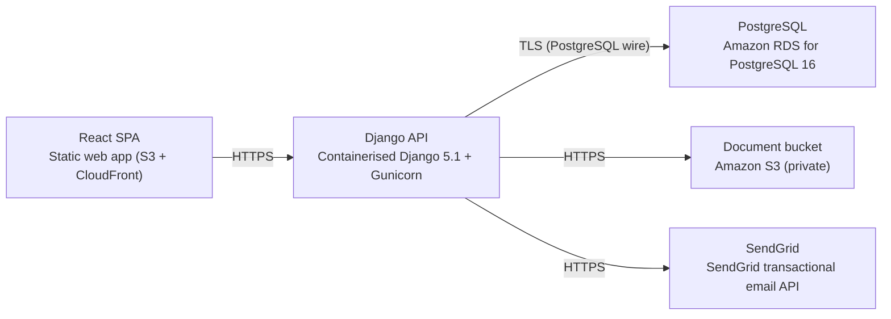

# Architecture

> Maintained by QuorQ AI SDLC. Text between `sdlc:auto` markers is regenerated; anything outside them is yours and is kept.

<!-- sdlc:auto:start narrative -->
## Overview

### ARCH-OVERVIEW · approved · source: architecture:summary

Approved v1 architecture for an internal single-organisation HRM web app for ~200 employees, built on React 19, Django 5.1/DRF, PostgreSQL 16, hosted on AWS Mumbai (ap-south-1), with S3 for documents and SendGrid for email.

Scope per architecture summary: email/password auth with three roles (employee, manager, HR/admin); employee records with spreadsheet bulk-import and S3 document upload; HR-configurable leave types/holidays with apply-approve-reject workflow and automatic balance updates; web check-in/check-out attendance; CSV/Excel reporting; and DPDP Act 2023 obligations (India data residency, privacy notice, owner/manager-only access to personal data, access audit logging). Status: approved, version 1.

- ⚠ Input does not map individual requirement ids (US-001..US-018) to specific architecture elements, so requirement-level traceability for this phase cannot be populated beyond this general summary.

### ARCH-COMP-WEB · approved · source: architecture:components.web_frontend

HRMS Web App is a React 19 responsive SPA serving all three roles with login, dashboards, profile, leave, attendance, reports and privacy notice screens.

Role-aware UI adapting to desktop and mobile browsers; single codebase for employee self-service, manager approvals, and HR/admin configuration and reporting. Deployed as a static web app (S3 + CloudFront) per deployment nodes.

### ARCH-COMP-API · approved · source: architecture:components.api_backend

HRMS API is a Django 5.1 service providing business logic and the REST API: auth, RBAC, employee records, document upload orchestration, leave workflow with balance updates, attendance, reporting/export, email dispatch, privacy notice, and access audit logging.

Containerised Django 5.1 + Gunicorn, deployed on AWS ECS Fargate (ap-south-1). Central component gluing the database, S3, and SendGrid together; owns all workflow rules (balance validation, overlap checks, transactional approval).

### ARCH-COMP-DB · approved · source: architecture:components.database

HRMS Database is PostgreSQL 16, the durable transactional store for users, employees, departments, leave config/balances/requests, attendance, holidays, correction requests, privacy notices and audit logs.

Enforces relational integrity so leave balances cannot drift. Hosted as Amazon RDS for PostgreSQL 16 in ap-south-1 per deployment nodes.

### ARCH-COMP-S3 · approved · source: architecture:components.object_storage

Document Storage is a private Amazon S3 bucket holding uploaded employee ID documents in AWS Mumbai region, served only via time-limited pre-signed URLs.

Files are never publicly guessable; access is mediated entirely through the API, which issues short-lived pre-signed URLs to authorised users. Deployment node: S3 (private) in ap-south-1.

### ARCH-COMP-EMAIL · approved · source: architecture:components.email_service

Transactional Email via SendGrid sends leave request/decision notifications and password reset links.

Email failures are logged without blocking the leave workflow, i.e. leave approvals/rejections and balance updates proceed even if notification delivery fails. SendGrid is accessed as a SaaS API over HTTPS per deployment nodes.

- ⚠ No detail given on how/where email failures are logged (e.g. which table or log sink) beyond the stated behavior that they don't block the workflow.

### ARCH-CP-LOGIN · approved · source: architecture:critical_paths.login_rbac

Login and role-based access critical path: credential check issues a JWT carrying role, and every subsequent request is authorised against role and ownership rules.

User submits email/password; API verifies credentials and returns a generic failure message on any mismatch (no indication of whether email or password was wrong, to resist enumeration). On success a JWT is issued carrying the user's role (employee, manager, or HR/admin). Every later API call is authorised against that role plus ownership rules (e.g. managers see only direct reports).

### ARCH-CP-LEAVE · approved · source: architecture:critical_paths.leave_apply_approve

Apply-and-approve leave critical path: validates balance/overlap, excludes holidays/weekends from deducted days, routes through a pending state, and updates balance transactionally on approval.

Employee applies for leave via POST /api/leave-requests; API validates leave balance and date overlaps, excludes holidays and weekends from the days deducted, creates a request in 'pending' status, and emails the manager. Manager decides via PATCH /api/leave-requests/{id}/decide: on approval the balance is reduced inside a database transaction and the employee is emailed; on rejection a decision_reason is recorded and the employee is emailed.

### ARCH-CP-UPLOAD · approved · source: architecture:critical_paths.document_upload

Secure document upload critical path: validated files are stored privately in S3 under an opaque key and later served only via short-lived pre-signed URLs.

An authorised user uploads a document via POST /api/employees/{id}/documents; API validates file type and size, stores the object privately in S3 under an opaque key (not the original filename), and links it to the employee record (employee_documents table). Retrieval is via GET /api/employees/{id}/documents/{doc_id}, which returns a time-limited pre-signed URL rather than a direct/public link.

### ARCH-DATA-MODEL · approved · source: architecture:entities

Relational data model spans 12 tables covering identity, org structure, employee records/documents, leave configuration and workflow, attendance, holidays/weekends, privacy notices, and audit logs.

Entities as defined: users(id, email, password_hash, role, is_active, created_at); departments(id, name); employees(id, user_id, first_name, last_name, work_email, phone, address, designation, department_id, manager_id, employment_start_date, employment_end_date); employee_documents(id, employee_id, doc_type, s3_key, file_name, content_type, size_bytes, uploaded_by, uploaded_at); correction_requests(id, employee_id, field_name, requested_value, status, created_at); leave_types(id, name, annual_balance, accrual_rule, is_active); leave_balances(id, employee_id, leave_type_id, year, balance); leave_requests(id, employee_id, leave_type_id, start_date, end_date, days_deducted, reason, status, decided_by, decision_reason, created_at); holidays(id, holiday_date, name); weekend_config(id, day_of_week); attendance(id, employee_id, work_date, check_in, check_out, worked_minutes); privacy_notices(id, version, content, published_at); audit_logs(id, user_id, action, resource, ip_address, created_at).

- ⚠ privacy_notices table stores content/version but there is no field or table recording an individual employee's acknowledgement/acceptance of a given notice version -- flagged under DPDP compliance gaps as well.

### ARCH-API-SURFACE · approved · source: architecture:endpoints

REST API surface of 24 endpoints spans auth, user admin, employee records/documents, leave configuration and workflow, attendance, reporting/export, and the privacy notice.

Auth: POST /api/auth/login (generic failure message); POST /api/auth/password-reset; POST /api/auth/password-reset/confirm. User admin: POST /api/users (HR/admin creates user+role); PATCH /api/users/{id}/deactivate (retains history). Employees: GET /api/employees (HR/admin full list, managers see direct reports only); POST /api/employees (mandatory-field validation); GET /api/employees/me; PATCH /api/employees/{id} (HR/admin edits; employee edits own correctable fields or files a correction request); POST /api/employees/import (bulk spreadsheet import, valid rows created, failures reported); POST /api/employees/{id}/documents (upload with type/size validation); GET /api/employees/{id}/documents/{doc_id} (pre-signed URL). Leave: POST /api/leave-types; POST /api/holidays; POST /api/leave-requests; GET /api/leave-requests/queue (manager, direct reports only); PATCH /api/leave-requests/{id}/decide. Attendance: POST /api/attendance/check-in (timestamp only, no geolocation/biometrics); POST /api/attendance/check-out (computes duration, blocks duplicate checkout); GET /api/attendance/me; GET /api/attendance/team (manager, date range). Reporting: GET /api/reports/{type} (date range/filters, empty result handled); GET /api/reports/{type}/export (CSV or Excel). Privacy: GET /api/privacy-notice (current version, any signed-in user).

- ⚠ No endpoint listed for querying/exporting audit_logs, even though the audit_logs table exists and access-audit logging is a stated DPDP obligation -- unclear how HR/admin would review audit trails.

### ARCH-DEPLOYMENT · approved · source: architecture:deployment_nodes

Deployment topology is entirely within AWS ap-south-1 (Mumbai): static SPA on S3+CloudFront, containerised API on ECS Fargate, RDS for PostgreSQL, a private S3 bucket for documents, and SendGrid as an external SaaS dependency.

React SPA: static web app on S3 + CloudFront, served to browsers/CDN. Django API: containerised Django 5.1 + Gunicorn on AWS ECS Fargate (ap-south-1). PostgreSQL: Amazon RDS for PostgreSQL 16 (ap-south-1). Document bucket: Amazon S3, private, ap-south-1. SendGrid: external SaaS, accessed over HTTPS. All first-party infrastructure resides in ap-south-1, supporting the stated India data-residency requirement; SendGrid is the one component outside AWS/India control and is used only for outbound transactional email, not data storage.

- ⚠ Architecture does not state SendGrid's own data-residency/processing location for the email content it transmits (names, leave dates in notification emails) -- relevant to confirm against DPDP residency expectations.

### ARCH-TECH-DECISIONS · approved · source: architecture:technology_decisions

Four stack decisions were made and justified: React 19 for frontend, Django 5.1 for backend, PostgreSQL 16 for the database, and AWS (ap-south-1) for cloud hosting.

Frontend - React 19 (vs Angular, Vue): one responsive codebase for three role-specific audiences on desktop and mobile, no native app needed. Backend - Django 5.1 (vs FastAPI, Spring Boot): ORM, migrations, built-in auth and password-reset tokens, and admin accelerate a records-and-workflow HRMS; DRF exposes the role-scoped REST API within one app. Database - PostgreSQL 16 (vs MySQL, SQLite): ACID transactions keep leave balances accurate, strong date-range handling for attendance/holiday calendars, JSONB covers accrual rules without a second data store. Cloud - AWS (vs Azure, GCP): ap-south-1 (Mumbai) keeps database and S3 documents in India for DPDP residency; RDS, S3 and compute form one coherent toolkit for a small internal system.

### ARCH-COMPLIANCE-DPDP · approved · source: architecture:summary (DPDP Act 2023 obligations)

DPDP Act 2023: data localisation -- architecture confirms all HR data and documents are hosted in AWS ap-south-1 (India), satisfying data-residency intent.

DPDP Act 2023: privacy notice -- privacy_notices entity (id, version, content, published_at) and GET /api/privacy-notice endpoint deliver the current notice to any signed-in user. DPDP Act 2023: purpose/access limitation -- role-based access (employee/manager/HR-admin) plus ownership rules restrict personal data visibility to the owner, their manager, and HR/admin (e.g. GET /api/employees scoped by role, document access only via pre-signed URL to authorised users). DPDP Act 2023: audit controls -- audit_logs entity (id, user_id, action, resource, ip_address, created_at) is defined to record access activity.

- ⚠ DPDP Act 2023: no endpoint exists to query/export audit_logs, so the audit-logging control is only partially evidenced (data is captured per the schema but review/reporting capability is not described).
- ⚠ DPDP Act 2023: no mechanism described for recording an individual's acknowledgement of a specific privacy_notices version, only the notice's own content and version.
- ⚠ DPDP Act 2023: data retention/erasure policy (e.g. how long employee_documents, attendance, or audit_logs are retained after an employee's employment_end_date) is not addressed anywhere in this architecture input.
<!-- sdlc:auto:end narrative -->

<!-- sdlc:auto:start building-blocks -->
## Building Block View

| ID | Name | Technology | Responsibility | Depends on |
|---|---|---|---|---|
| web_frontend | HRMS Web App | React 19 | Responsive role-aware UI for employees, managers and HR/admin: login, dashboards, profile, leave, attendance, reports and privacy notice. Adapts to desktop and mobile browsers. | api_backend |
| api_backend | HRMS API | Django 5.1 | Business logic and REST API: authentication, RBAC, employee records, document upload orchestration, leave workflow with balance updates, attendance, reporting/export, email dispatch, privacy notice, and access audit logging. | database, object_storage, email_service |
| database | HRMS Database | PostgreSQL 16 | Durable, transactional store for users, employees, departments, leave config/balances/requests, attendance, holidays, correction requests, privacy notices and audit logs. Enforces relational integrity so balances cannot drift. | — |
| object_storage | Document Storage | Amazon S3 | Private, durable storage of uploaded employee documents (ID proofs) in the AWS Mumbai region, served only through time-limited pre-signed URLs so files are never publicly guessable. | — |
| email_service | Transactional Email | SendGrid | Sends leave request/decision notifications and password reset links. Failures are logged without blocking the leave workflow. | — |

<!-- sdlc:auto:end building-blocks -->

<!-- sdlc:auto:start runtime -->
## Runtime View

### Login and role-based access

User submits email/password, the API verifies credentials with a generic failure message, issues a JWT carrying the role, and every subsequent request is authorised against the role and ownership rules.

- **Components:** web_frontend, api_backend, database
- **Modules:** auth.views, auth.permissions, accounts.models
- **Key functions:** login(email, password), issue_jwt(user), has_role_permission(user, resource), scope_to_direct_reports(manager, queryset)

### Apply and approve leave with balance update

Employee applies for leave; the API validates balance and date overlaps, excludes holidays/weekends from deducted days, creates a pending request, and emails the manager. On approval the balance is reduced inside a transaction and the employee is emailed.

- **Components:** web_frontend, api_backend, database, email_service
- **Modules:** leave.views, leave.services, leave.calendar, notifications.email
- **Key functions:** working_days(start, end, holidays, weekends), validate_balance(employee, type, days), detect_overlap(employee, start, end), approve_request(request_id, manager), send_notification(template, to)

### Secure document upload to S3

An authorised user uploads a document; the API validates type and size, stores it privately in S3 under an opaque key, links it to the employee, and later serves it only via a short-lived pre-signed URL.

- **Components:** web_frontend, api_backend, object_storage, database
- **Modules:** documents.views, documents.storage, documents.validators
- **Key functions:** validate_upload(file, allowed_types, max_size), put_private_object(key, file), presign_url(key, ttl), check_document_access(user, employee)

<!-- sdlc:auto:end runtime -->

<!-- sdlc:auto:start deployment-view -->
## Deployment View

| Name | Service | Runtime | Scaling | Environment |
|---|---|---|---|---|
| React SPA | Static web app (S3 + CloudFront) | Browser / CDN | CDN edge | dev |
| Django API | Containerised Django 5.1 + Gunicorn | AWS ECS Fargate (ap-south-1) | 1-2 tasks, adequate for ~200 employees | dev |
| PostgreSQL | Amazon RDS for PostgreSQL 16 | RDS (ap-south-1) | Single instance, encrypted at rest | dev |
| Document bucket | Amazon S3 (private) | S3 (ap-south-1) | Managed | dev |
| SendGrid | SendGrid transactional email API | SaaS (HTTPS) | Managed | dev |

| Source | Target | Protocol |
|---|---|---|
| React SPA | Django API | HTTPS |
| Django API | PostgreSQL | TLS (PostgreSQL wire) |
| Django API | Document bucket | HTTPS |
| Django API | SendGrid | HTTPS |

<!-- sdlc:auto:end deployment-view -->

<!-- sdlc:auto:start decisions -->
## Architecture Decisions

| Layer | Choice | ADR |
|---|---|---|
| Frontend | React 19 | [ADR-0001](adr/frontend.md) |
| Backend | Django 5.1 | [ADR-0002](adr/backend.md) |
| Database | PostgreSQL 16 | [ADR-0003](adr/database.md) |
| Cloud | AWS | [ADR-0004](adr/cloud.md) |
<!-- sdlc:auto:end decisions -->

<!-- sdlc:auto:start links -->
## Related Documents

- [Data Model](data-model.md)
- [API Specification](api/openapi.yaml)
- [Architecture Decision Records](adr/README.md)
<!-- sdlc:auto:end links -->
