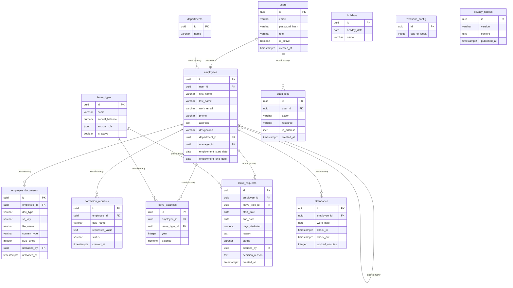

# Data Model

<!-- sdlc:auto:start entities -->
### users

| Field | Type | PK | FK | Nullable |
|---|---|---|---|---|
| id | uuid | True | — | False |
| email | varchar | False | — | False |
| password_hash | varchar | False | — | False |
| role | varchar | False | — | False |
| is_active | boolean | False | — | False |
| created_at | timestamptz | False | — | False |

### departments

| Field | Type | PK | FK | Nullable |
|---|---|---|---|---|
| id | uuid | True | — | False |
| name | varchar | False | — | False |

### employees

| Field | Type | PK | FK | Nullable |
|---|---|---|---|---|
| id | uuid | True | — | False |
| user_id | uuid | False | users.id | False |
| first_name | varchar | False | — | False |
| last_name | varchar | False | — | False |
| work_email | varchar | False | — | False |
| phone | varchar | False | — | True |
| address | text | False | — | True |
| designation | varchar | False | — | True |
| department_id | uuid | False | departments.id | True |
| manager_id | uuid | False | employees.id | True |
| employment_start_date | date | False | — | False |
| employment_end_date | date | False | — | True |

### employee_documents

| Field | Type | PK | FK | Nullable |
|---|---|---|---|---|
| id | uuid | True | — | False |
| employee_id | uuid | False | employees.id | False |
| doc_type | varchar | False | — | False |
| s3_key | varchar | False | — | False |
| file_name | varchar | False | — | False |
| content_type | varchar | False | — | False |
| size_bytes | integer | False | — | False |
| uploaded_by | uuid | False | users.id | False |
| uploaded_at | timestamptz | False | — | False |

### correction_requests

| Field | Type | PK | FK | Nullable |
|---|---|---|---|---|
| id | uuid | True | — | False |
| employee_id | uuid | False | employees.id | False |
| field_name | varchar | False | — | False |
| requested_value | text | False | — | False |
| status | varchar | False | — | False |
| created_at | timestamptz | False | — | False |

### leave_types

| Field | Type | PK | FK | Nullable |
|---|---|---|---|---|
| id | uuid | True | — | False |
| name | varchar | False | — | False |
| annual_balance | numeric | False | — | False |
| accrual_rule | jsonb | False | — | False |
| is_active | boolean | False | — | False |

### leave_balances

| Field | Type | PK | FK | Nullable |
|---|---|---|---|---|
| id | uuid | True | — | False |
| employee_id | uuid | False | employees.id | False |
| leave_type_id | uuid | False | leave_types.id | False |
| year | integer | False | — | False |
| balance | numeric | False | — | False |

### leave_requests

| Field | Type | PK | FK | Nullable |
|---|---|---|---|---|
| id | uuid | True | — | False |
| employee_id | uuid | False | employees.id | False |
| leave_type_id | uuid | False | leave_types.id | False |
| start_date | date | False | — | False |
| end_date | date | False | — | False |
| days_deducted | numeric | False | — | False |
| reason | text | False | — | True |
| status | varchar | False | — | False |
| decided_by | uuid | False | users.id | True |
| decision_reason | text | False | — | True |
| created_at | timestamptz | False | — | False |

### holidays

| Field | Type | PK | FK | Nullable |
|---|---|---|---|---|
| id | uuid | True | — | False |
| holiday_date | date | False | — | False |
| name | varchar | False | — | False |

### weekend_config

| Field | Type | PK | FK | Nullable |
|---|---|---|---|---|
| id | uuid | True | — | False |
| day_of_week | integer | False | — | False |

### attendance

| Field | Type | PK | FK | Nullable |
|---|---|---|---|---|
| id | uuid | True | — | False |
| employee_id | uuid | False | employees.id | False |
| work_date | date | False | — | False |
| check_in | timestamptz | False | — | False |
| check_out | timestamptz | False | — | True |
| worked_minutes | integer | False | — | True |

### privacy_notices

| Field | Type | PK | FK | Nullable |
|---|---|---|---|---|
| id | uuid | True | — | False |
| version | varchar | False | — | False |
| content | text | False | — | False |
| published_at | timestamptz | False | — | False |

### audit_logs

| Field | Type | PK | FK | Nullable |
|---|---|---|---|---|
| id | uuid | True | — | False |
| user_id | uuid | False | users.id | True |
| action | varchar | False | — | False |
| resource | varchar | False | — | False |
| ip_address | inet | False | — | True |
| created_at | timestamptz | False | — | False |
<!-- sdlc:auto:end entities -->

<!-- sdlc:auto:start relationships -->
| Source | Target | Type |
|---|---|---|
| users | employees | one-to-one |
| departments | employees | one-to-many |
| employees | employees | one-to-many |
| employees | employee_documents | one-to-many |
| employees | correction_requests | one-to-many |
| employees | leave_balances | one-to-many |
| leave_types | leave_balances | one-to-many |
| employees | leave_requests | one-to-many |
| leave_types | leave_requests | one-to-many |
| employees | attendance | one-to-many |
| users | audit_logs | one-to-many |
<!-- sdlc:auto:end relationships -->

<!-- sdlc:auto:start er-diagram -->

<!-- sdlc:auto:end er-diagram -->
