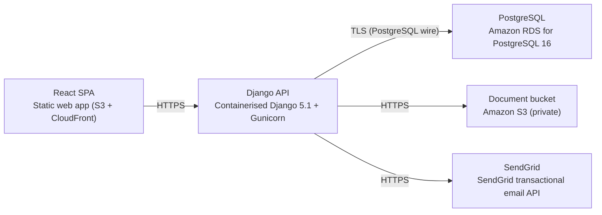

# Deployment Guide

> Maintained by QuorQ AI SDLC. Text between `sdlc:auto` markers is regenerated; anything outside them is yours and is kept.

<!-- sdlc:auto:start how-it-deploys -->
Pushes to `main` run `.github/workflows/deploy.yml`, which builds the API image (if there is a backend) and deploys the SPA to AWS Amplify. Commits touching only `docs/sdlc/**` don't deploy. Deployments can also be started from the platform's Deployment tab.
<!-- sdlc:auto:end how-it-deploys -->

<!-- sdlc:auto:start environments -->
| Name | Service | Runtime | Scaling | Environment |
|---|---|---|---|---|
| React SPA | Static web app (S3 + CloudFront) | Browser / CDN | CDN edge | dev |
| Django API | Containerised Django 5.1 + Gunicorn | AWS ECS Fargate (ap-south-1) | 1-2 tasks, adequate for ~200 employees | dev |
| PostgreSQL | Amazon RDS for PostgreSQL 16 | RDS (ap-south-1) | Single instance, encrypted at rest | dev |
| Document bucket | Amazon S3 (private) | S3 (ap-south-1) | Managed | dev |
| SendGrid | SendGrid transactional email API | SaaS (HTTPS) | Managed | dev |
<!-- sdlc:auto:end environments -->

<!-- sdlc:auto:start live -->
**Frontend URL:** https://pf67701e45cb6.dshared.amplifyapp.local

**Backend URL:** https://f67701e45cb6.local.awsapprunner.local

**Database:** PostgreSQL · aisdlc_f67701e45cb6

**Version:** a5550425235f

**Commit:** `a555042`

**Finished:** 2026-10-30
<!-- sdlc:auto:end live -->

<!-- sdlc:auto:start topology -->

<!-- sdlc:auto:end topology -->
